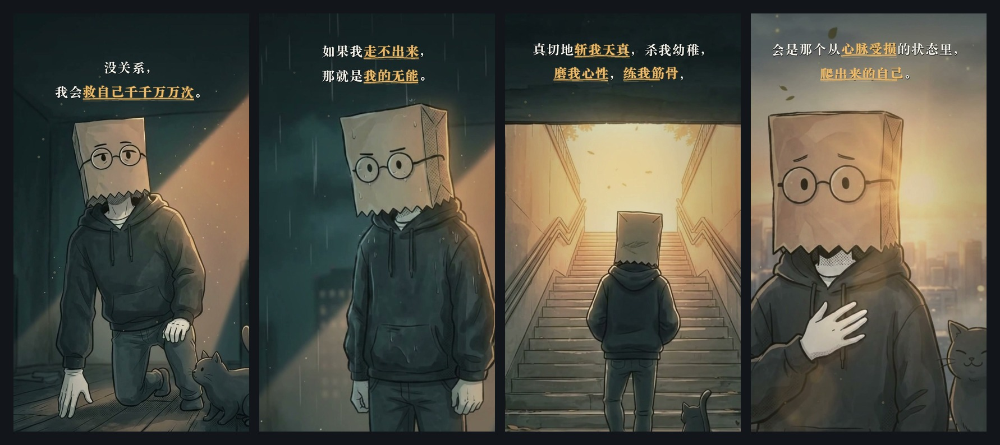
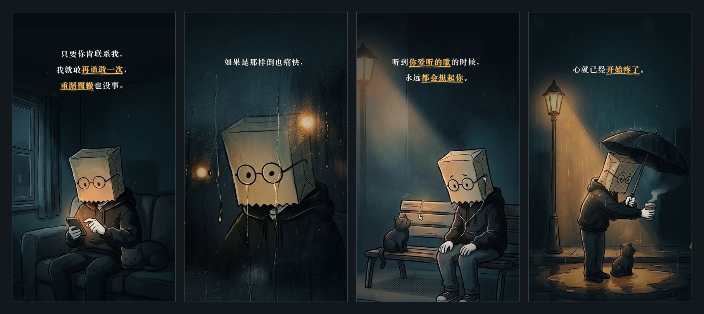

# Paperbag Emo (`paperbag-emo`) v2.0

> **深夜纸袋人 & 慵懒黑猫（Paperbag & Black Cat）** —— 统一炭笔墨线、圆形半调网点与深夜电影感配色的 **AI Agent 个人 IP 图片与真动画短视频创作 Skill**。  
> 一套 Skill 覆盖 **三大创作方式**：**① 一图流解释图 & 透明素材**、**② 静态母图 → 9:16 漫画电影感短视频**、**③ 图生视频 → AI 审片避坑与电影级真动画精剪合成（Mode C 2.0）**。全流程本地可复现（`Python + Pillow + FFmpeg`），零外部付费 API 依赖，采用 **MIT** 协议开源。

[](LICENSE)


---

## 这个项目可以干什么？（三大创作方式，自由切换与混剪）

安装 `paperbag-emo` 后，你可以按需选择以下 **3 种创作路径**（且支持在同一支视频里将「静帧图」与「动态视频」自由混剪）：

### 方式一｜图片创作：做解释图 & 可复用透明素材（Mode A / Mode B）

- **Mode A — 概念 / 机制 / 情绪一图流解释图（Explanatory Image）**
  - **适用场景**：公众号文章配图、小红书干货/情绪图文、产品机制拆解、双态对比图。
  - **核心能力**：先产出 8 字段结构化 `Visual Brief`，再以 `Text (verbatim)` 逐字锁定中英文标签直接成图；通过真实物件、光影对比与清晰路径（1 个核心动作、至多 3 个视觉区块），让读者在 **10 秒内看懂一个概念或情绪转折**。
- **Mode B — 无白边可复用透明插画资产（Transparent RGBA PNG）**
  - **适用场景**：IP 头像、PPT 演讲插图、视频前景贴纸、封面与海报排版。
  - **核心能力**：支持单独绘制**纸袋人**、**慵懒黑猫**、**二者组合**或**纯炭笔墨线独立物件**。配合内置抠图脚本 [scripts/cutout.py](scripts/cutout.py) 去绿幕（`#00FF00` / `#FF00FF`）与去色溢处理，专门保护暖棕牛皮纸袋与炭黑卫衣不透光（`--non-key-opaque-threshold 115`），**无白色贴纸描边**。

### 方式二｜图片 → 合成视频：9:16 漫画电影感卡点短片（Mode C · Motion Comic，零视频额度成本）

- **适用场景**：日更走量、零视频生成成本的抖音 / 视频号 / 小红书深夜情绪短片与金句独白。
- **核心能力**：你只需给出一段文案，Agent 自动完成**「一文案一分镜」导演拆解**并输出适配 Gemini Nano Banana 2.5 / Midjourney / 即梦的中英文 `Prompt Pack`；把生好的 **4–6 张静态母图** 交给 Agent 后，由本地渲染引擎 [scripts/render_emo_video.py](scripts/render_emo_video.py) 全自动合成：
  - **无重影 2.5D 平滑推镜（`camera_morph`）**：相邻两幕复用同一母图做 B 机位特写时，自动启用视口平滑插值推轨，100% 根除普通 `crossfade` 叠化导致的「双头重影」；
  - **自然低频 5 阶平滑眨眼（`natural_blink`）**：支持 3 帧序列（睁眼 → 半眯过渡帧 → 轻闭眼 → 半眯 → 睁眼）与可调低频节奏（默认 `blink_interval: 3.8s`、`blink_delay: 1.45s`、`blink_duration: 0.24s`），彻底告别硬切与高频抢拍；
  - **小猫局部微动态与像素锁死动效**：在源图空间内支持小猫底部锚定轻呼吸起伏（`cat_box`）与错拍轻抖耳（`cat_ear_box`），以及随镜头推拉零漂移的手机空白输入框闪烁光标（`cursor_blink`）；
  - **电影级多维氛围层**：内置暖光源自动追踪（`light_pos: "auto"`）、分层景深雨丝（`rain_glass`）、水平慢漂夜雾（`mist_drift`）、逆光暖金微尘（`dust_drift`）、水面/湿路微光涟漪（`water_shimmer`）、热气、散景与 16mm 胶片颗粒；
  - **第 0 帧封面标题与发光字幕**：第 0 帧（`t = 0.00s`）自动渲染完整首句标题与手绘琥珀下划线，解决抖音默认封面无字痛点；提供 `60px` 衬线逐字级联与解耦转场。

### 方式三｜图生视频 → 最终精剪合成：真动画电影级封装（Mode C 2.0 · Live Anime & Hybrid）

- **适用场景**：打造抖音/小红书旗舰爆款短片，让纸袋人与黑猫真正动起来（起身、淋雨闭眼、走上长阶、窗帘随风飘、黑猫抬爪安慰与微笑），彻底突破平台静态图文流量天花板。
- **核心能力（解决 AI 图生视频落地的「最后一公里」）**：
  1. **双套联动提示词**：Agent 一次输出「9:16 母图提示词 + 锁死 2D 炭笔半调画风的 Gemini Veo / 即梦 / 可灵 图生视频提示词」；
  2. **AI 逐秒审片抓穿帮 + 精准截断（`video_start` / `video_speed`）**：把生成的原始 `.mp4` 交给 Agent 后，AI 先逐秒审片，自动避开 AI 视频后半段常见的怪烟/穿帮帧，只截取动作与情绪最完美的黄金片段；
  3. **原生动态视频 `scene_video` 与动态 `camera_morph` 推镜**：本地引擎直接解码 `.mp4 / .mov / .webm / .gif`，在同一段动态视频上无缝执行中景 → 特写平滑推轨（雨滴、脚步与眨眼全程不停帧），同时支持**静态母图与动态视频自由混剪**；
  4. **统一 35mm 电影调色与字幕避让（`text_y`）**：统一 `midnight_emo` 调色曲线与 `luma_fade` / `warm_dissolve` 呼吸转场，按镜头构图微调 `text_y` 防止字幕压头或落入亮天空，输出抖音无声成片（`_silent.mp4`）与节拍预览版（`_beat_preview.mp4`）。

---

## 视频成片效果一览（Mode C 2.0 真动画 & Mode C 静帧电影）

### 1. Mode C 2.0 真动画旗舰案例：《我会救自己千千万万次》（5 段 Gemini I2V 动态视频 → 8 幕精剪 · 78 BPM · 27.31s）

对应配置：[studio/ziji_timeline.json](studio/ziji_timeline.json) | 双套提示词包：[studio/ziji_prompt_pack.md](studio/ziji_prompt_pack.md)



- **贴地起身睁眼**（精准截取 `4.2s` 起身睁眼片段，避开前段光效穿帮） → **天台冷雨不打伞**（真实雨丝 + 动态 `camera_morph` 推近冷峻眉眼） → **地下长阶拾级而上**（`0.68x` 慢放 + `text_y: 235` 稳嵌隧道暗顶棚，避开脑后镜框闪烁） → **晨光按胸致敬自己**（`camera_morph` 推近睁眼瞬间 + 微笑黑猫）。

### 2. Mode C 静帧漫画电影案例：《三千梨树六百湘水》&《克制与想念 / 产生怜惜》

对应配置：[studio/sanqian_timeline.json](studio/sanqian_timeline.json) | [studio/xiangni_timeline.json](studio/xiangni_timeline.json) | [studio/lianxi_timeline.json](studio/lianxi_timeline.json)




---

## IP 角色与视觉规范（Character Anchor）

所有图片与视频分镜均锁定统一视觉语言，使用外置生图模型时建议将 [assets/master_ref.jpg](assets/master_ref.jpg) 作为角色特征参考图上传：

- **主角（Paperbag）**：折叠牛皮纸袋头套（底部锯齿边缘）、细黑圆框眼镜、小黑点眉眼、宽大炭黑连帽卫衣、白色漫画手。
- **搭档（Black Cat）**：圆润炭黑短毛猫、小尖耳、极简胡须与克制神态（可按文案需求单独出现、双角色同框，或在纯空镜中隐去）。
- **色彩与线稿纪律**：炭笔黑变粗细轮廓 + 圆形半调网点阴影；全片严格克制为**暖琥珀（Warm Amber）+ 冷暗青（Muted Slate-Teal）**双强调色。

<p align="center">
  
</p>

---

## 三大创作方式能力总览

| 创作方式 | 对应模式 | 输入素材 | 核心用途 | 输出产物 | 核心脚本 / 规范 |
| :--- | :--- | :--- | :--- | :--- | :--- |
| **1. 图片创作** | **Mode A / B** | 主题观点 / 动作描述 | 概念科普一图流、情绪图文、头像、无白边透明贴纸 | 完整插画 / RGBA 透明 PNG | [SKILL.md](SKILL.md) + [scripts/cutout.py](scripts/cutout.py) |
| **2. 图片 → 视频** | **Mode C (Path A/B)** | 文案 + 静态母图 / 透明贴纸 | 零视频成本 9:16 漫画电影感卡点短片（`camera_morph` + 眨眼） | `_silent.mp4` + `_beat_preview.mp4` | [scripts/render_emo_video.py](scripts/render_emo_video.py) |
| **3. 图生视频 → 终版精剪** | **Mode C 2.0 (Path C)** | 文案 + 原始 `.mp4` 动图（可与静帧混剪） | AI 逐秒审片避坑截断、动态推镜、统一调色与防压头字幕封装 | 电影级真动画 `_silent.mp4` | [scripts/render_emo_video.py](scripts/render_emo_video.py)（`scene_video`） |

---

## 快速安装与使用（Quick Start）

### 1. 环境依赖

- **Python** `3.10+` & **Pillow**（`pip install pillow`）
- **FFmpeg**（确保 `ffmpeg` 在 `PATH` 中：`brew install ffmpeg` / `winget install Gyan.FFmpeg` / `sudo apt install ffmpeg`）

### 2. 作为 Agent Skill 安装

```bash
npx skills add a916791360/paperbag-emo
```

或手动复制本仓库目录至你的 Agent Skill 目录（例如 `~/.gemini/config/skills/paperbag-emo` 或 `~/.claude/skills/paperbag-emo`）。

### 3. Mode C / Mode C 2.0 视频引擎命令行用法

```bash
# 1) 检查 FFmpeg 与跨平台中文字体探测（macOS / Windows / Linux）
python3 scripts/render_emo_video.py --check

# 2) 渲染前校验分镜字数断句、高亮词、景别多样性、scene_video 路径与拍数节奏
python3 scripts/render_emo_video.py --validate --timeline studio/ziji_timeline.json

# 3) 渲染 9:16 竖屏无声成片（上传抖音自选配乐）与节拍预览版
python3 scripts/render_emo_video.py \
  --timeline studio/ziji_timeline.json \
  --out studio/output/ziji_live_anime \
  --theme late_night \
  --fps 30
```

> **Mode C 2.0 `scene_video` 分镜字段示例**（支持与 `scene_image` 在同一份 `timeline.json` 中自由混剪）：
> ```json
> {
>   "beats": 5.0,
>   "scene_video": "studio/scenes/ziji/s5_own_benefactor_sunrise.mp4",
>   "video_start": 4.46,
>   "video_speed": 1.0,
>   "video_loop": "clamp",
>   "crop_box": [0.10, 0.01, 0.88, 0.79],
>   "transition": "camera_morph",
>   "text_y": 235,
>   "lines": ["会是那个从心脉受损的状态里，", "爬出来的自己。"],
>   "highlight": ["心脉受损", "爬出来的自己"]
> }
> ```

### 4. Mode B 去绿幕与去色溢抠图用法

```bash
python3 scripts/cutout.py source.jpg assets/stickers/new_pose.png \
  --transparent-threshold 32 \
  --opaque-threshold 220 \
  --non-key-opaque-threshold 115
```

### 5. 运行单元测试（18 项自动化校验）

```bash
python3 -m unittest discover -s tests -v
```

---

## 仓库目录结构

```text
├── SKILL.md                           # Skill 主规范（三大创作方式 + Mode C 2.0 审片避坑精剪 SOP）
├── LICENSE                            # MIT 开源协议
├── agents/openai.yaml                 # 多宿主 Skill 元数据
├── assets/
│   ├── master_ref.jpg                 # IP 角色基准参考图
│   └── stickers/                      # 透明动作库（thinking / emo_hug / emo_hug_blink / calm_cup）
├── examples/                          # GitHub README 成片与分镜展示图（含 Mode C 2.0 真动画案例）
├── scripts/
│   ├── cutout.py                      # Mode B 去绿幕与去色溢抠图脚本
│   └── render_emo_video.py            # Mode C / 2.0 漫画电影与原生动态视频精剪引擎
├── studio/
│   ├── ziji_timeline.json             # Mode C 2.0 真动画示例：《我会救自己千千万万次》（+ ziji_prompt_pack.md）
│   ├── yihan_timeline.json            # Mode C 2.0 真动画示例：《爱情里的两种遗憾》（+ yihan_prompt_pack.md）
│   ├── daobie_timeline.json           # Mode C 静帧升级示例：《没有好好道别》（5阶眨眼+小猫微动+夜雾/闪烁光标）
│   ├── zhufu_timeline.json            # Mode C 静帧示例：《我总是祝福着你》（+ zhufu_prompt_pack.md）
│   ├── ganxie_timeline.json           # Mode C 静帧示例：《感谢那位特殊的人》（+ ganxie_prompt_pack.md）
│   ├── sanqian_timeline.json          # Mode C 静帧示例：《三千梨树六百湘水》（+ sanqian_prompt_pack.md）
│   ├── xiangni_timeline.json          # Mode C 静帧示例：《克制与想念》（+ xiangni_prompt_pack.md）
│   ├── lianxi_timeline.json           # Mode C 静帧示例：《产生怜惜》（+ lianxi_prompt_pack.md）
│   ├── chengyi_timeline.json          # Mode C 静帧示例：《最大的诚意》（+ chengyi_prompt_pack.md）
│   └── scenes/                        # 分镜母图、眨眼帧与本地动态视频目录（.mp4 由 .gitignore 忽略）
└── tests/
    └── test_pipeline.py               # 断句、校验、camera_morph、首帧封面、scene_video 与抠图单元测试
```

---

## License

本项目采用 [MIT License](LICENSE) 开源协议。
