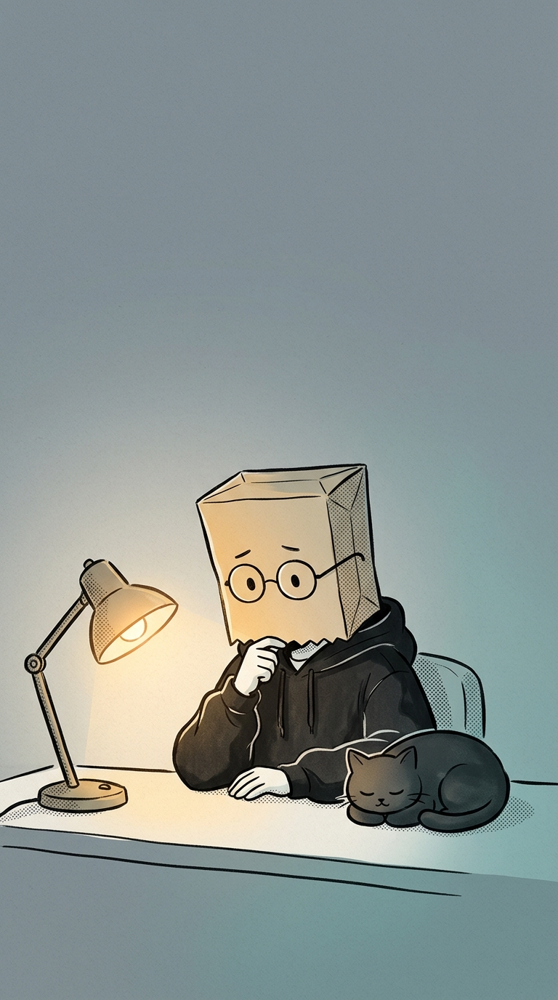
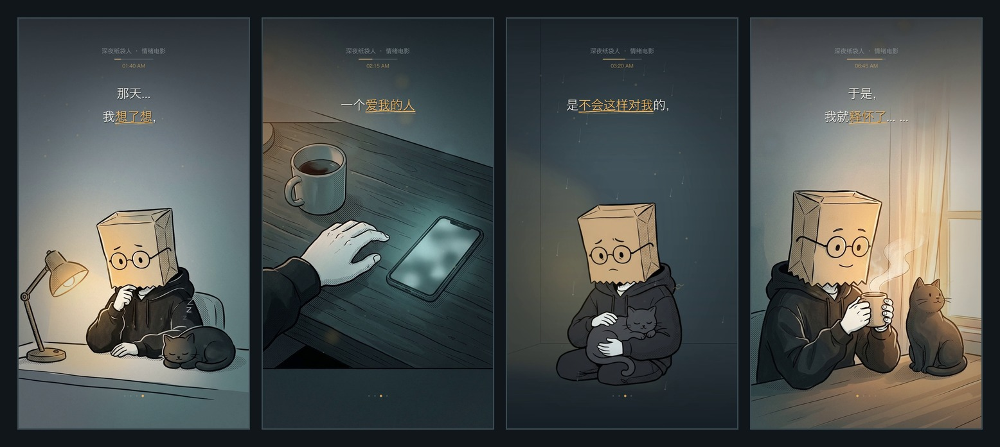
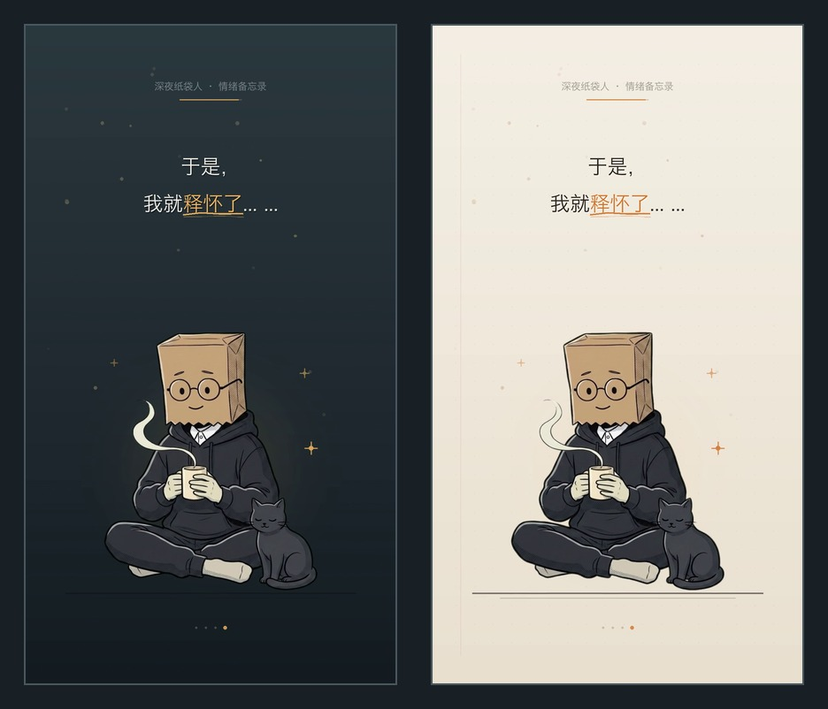
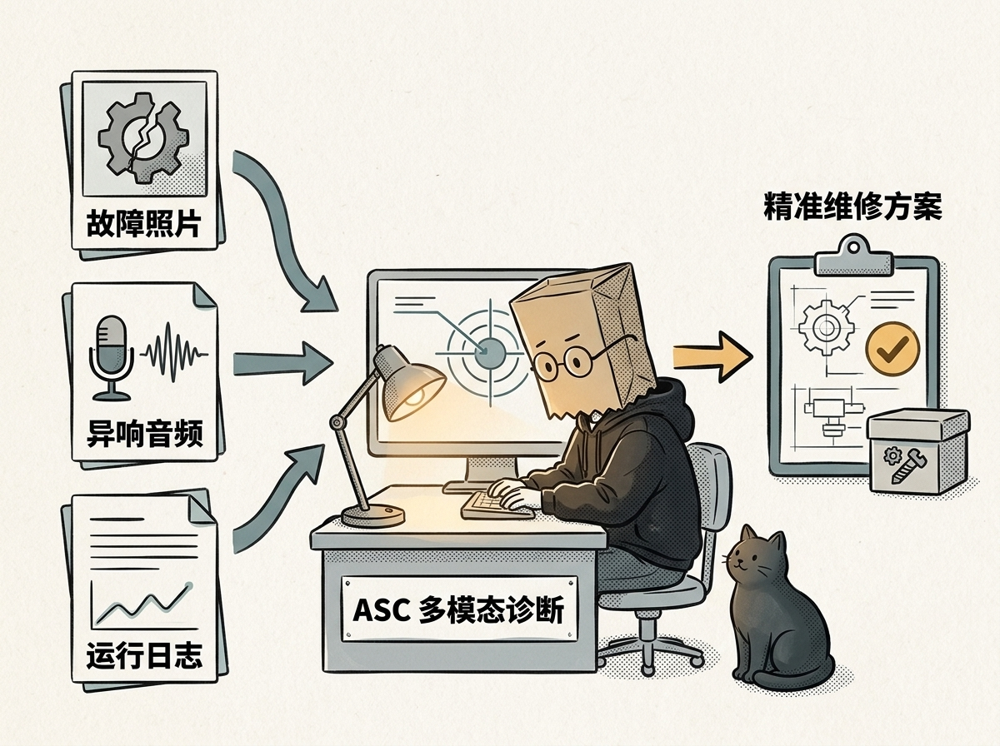

# Paperbag Emo (`paperbag-emo`)

> **深夜纸袋人 & 慵懒黑猫（Paperbag & Black Cat）** —— 统一炭笔墨线与半调网点风格的 AI Agent 视觉与短视频创作 Skill。  
> Strictly local rendering (`Python + Pillow + FFmpeg`), zero external video/image API keys required, licensed under **MIT**.

[](LICENSE)


---

## 视觉效果一览（What This Skill Produces）

### 1. IP 角色基准设定（Character Anchor）

所有产物均锁定 [assets/master_ref.jpg](assets/master_ref.jpg) 的炭笔墨线、变粗细轮廓、圆形半调网点（Halftone）及克制的**暖琥珀（Warm Amber）+ 冷暗青（Muted Slate-Teal）**双强调色规范：

<p align="center">
  
</p>

---

### 2. Mode C — 9:16 漫画电影感 BPM 卡点视频（Motion Comic）

围绕文案语义生成定制多景别 9:16 分镜（远景确立、手部/物件空镜、近景情绪、晨光收尾），结合 **2.5D 前景视差**、**自然眨眼序列（人/猫同步眨眼）**、**黑猫睡眠 `z Z z` / 呼噜波纹 / 手机微光脉冲**、**柔和热气与晨光束**，输出抖音无声版（`_silent.mp4`）与节拍预览版（`_beat_preview.mp4`）：



支持 **`late_night`（深夜暗青）** 与 **`paper_cream`（手账米白）** 双主题及自定义 `--bg` 背景图：



---

### 3. Mode A — 概念 / 机制 / 情绪一图流解释图

用真实物件、光影对比与精确中文标签直接成图，10 秒内讲清一个概念、流程或情绪对比：



---

### 4. Mode B — 无白边可复用透明插画资产（RGBA）

通过绿幕/透明通道与 [scripts/cutout.py](scripts/cutout.py) 去色溢抠图（保护暖棕牛皮纸袋与炭黑卫衣不透光），在深浅两种底色上均能干净融合、无白色贴纸描边：


---

## 核心特性（Key Capabilities）

- **三模式严格分工**：
  - **Mode A**：单张完整概念/情绪解释图（带 `Text (verbatim)` 逐字标签防错与单点纠错重试）
  - **Mode B**：透明 PNG 动作/物件资产（`cutout.py` 含 `--non-key-opaque-threshold 115` 内部保护）
  - **Mode C**：BPM 节拍卡点 9:16 视频合成引擎（`render_emo_video.py`）
- **「一文案一分镜」导演标准**：按文案字数动态决定总时长与分镜数，强制相邻两幕景别轮换，支持长文案中文标点智能断句与 `--validate` 节奏可读性校验。
- **丰富的感官微动态与伴侣交互**：支持 `natural_blink` 眨眼序列、`fg_parallax` 2.5D 前景视差、`coffee_steam`、`sunbeams`、`bokeh_depth`、`rain_glass`、`lamp_flicker`、`cat_zzz`、`purr_waves`、`prop_pulse` 与 `film_grain`。
- **跨平台零外部付费依赖**：自动探测 macOS / Windows / Linux 中文字体，自带 `ffmpeg` 环境自检与无声/节拍双轨 MP4 导出。

---

## 快速安装与使用（Quick Start）

### 1. 环境依赖

- **Python** `3.10+` & **Pillow**（`pip install pillow`）
- **FFmpeg**（确保 `ffmpeg` 在 `PATH` 中：`brew install ffmpeg` / `winget install Gyan.FFmpeg` / `sudo apt install ffmpeg`）

### 2. 作为 Agent Skill 安装

```bash
# 使用 skills CLI（仓库公开后或已配置权限时）
npx skills add a916791360/paperbag-emo
```

或手动复制本仓库目录至你的 Agent Skill 目录（例如 `~/.gemini/config/skills/paperbag-emo` 或 `~/.claude/skills/paperbag-emo`）。

### 3. Mode C 视频引擎命令行用法

```bash
# 1) 检查 FFmpeg 与跨平台中文字体探测
python3 scripts/render_emo_video.py --check

# 2) 渲染前校验分镜字数断句与拍数节奏
python3 scripts/render_emo_video.py --validate --timeline studio/shihuai_route3_timeline.json

# 3) 渲染 9:16 无声版（传抖音自选配乐）与节拍预览版
python3 scripts/render_emo_video.py \
  --timeline studio/shihuai_route3_timeline.json \
  --out studio/output/shihuai_route3 \
  --theme late_night \
  --fps 30
```

### 4. Mode B 去绿幕抠图用法

```bash
python3 scripts/cutout.py source.jpg assets/stickers/new_pose.png \
  --transparent-threshold 32 \
  --opaque-threshold 220 \
  --non-key-opaque-threshold 115
```

---

## 仓库目录结构

```text
├── SKILL.md                         # Skill 主规范（Mode A / B / C 完整工作流与导演法则）
├── LICENSE                          # MIT 开源协议
├── agents/openai.yaml               # 多宿主 Skill 元数据
├── assets/
│   ├── master_ref.jpg               # IP 唯一角色基准图
│   └── stickers/                    # 已质检透明动作库（thinking / emo_hug / calm_cup）
├── examples/                        # 三模式成片与视觉效果示例图
├── scripts/
│   ├── cutout.py                    # 去绿幕与去色溢抠图脚本
│   └── render_emo_video.py          # Mode C 9:16 漫画电影与卡点渲染引擎
└── studio/                          # 示例分镜配置与定制场景画格
```

---

## License

本项目采用 [MIT License](LICENSE) 开源协议。
